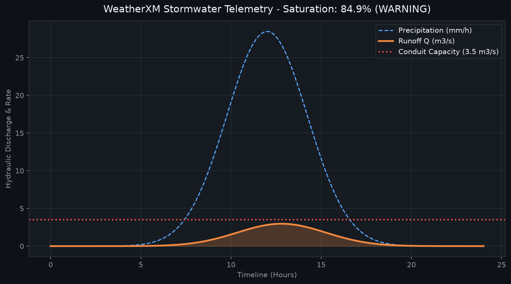

# WeatherXM Smart Stormwater Infrastructure

[](https://github.com/fazeli1977-dot/weatherxm-smart-stormwater/actions/workflows/ci.yml)
[](https://github.com/fazeli1977-dot/weatherxm-smart-stormwater/releases)
[](LICENSE)
[](https://www.python.org/)
[](https://weatherxm.com)

**Engineering Intelligence · Software Development · Applied AI**

**WeatherXM Smart Stormwater** is an engineering demonstrator (prototype) that explores
using hyper-local weather observations from the WeatherXM network as an input to a
simplified urban stormwater runoff assessment. It is not an operational flood-forecasting
system, has not been validated against field measurements, and does not claim proven
flood mitigation or production readiness.

The repository contains two complementary pieces of software:

- A **command-line tool** (`wxm-stormwater`) that can fetch a live station observation
  from the WeatherXM API when an API key is supplied, and otherwise uses a built-in
  simulated demo observation. It computes a Rational Method peak discharge and a
  capacity-saturation risk advisory.
- A **Streamlit dashboard** (`wxm-stormwater-dashboard`) that currently operates
  entirely on simulated weather and hydrograph data for demonstration purposes.

## Supervisory Dashboard Preview



> Local dashboard entrypoint: `http://localhost:8501`

---

## Purpose

The project demonstrates, in a compact and reproducible form, how a weather observation
can be translated into a hydraulic load estimate for a user-defined catchment:

- Ingest a precipitation intensity (live from WeatherXM when available, otherwise a
  fixed demo value).
- Apply the Rational Method (`Q = 0.00278 * C * I * A`) to estimate peak discharge.
- Compare the estimated discharge against a user-supplied conduit/network capacity.
- Report a saturation percentage and an advisory risk level (`NORMAL`, `WATCH`,
  `WARNING`, `CRITICAL`).

The hydrology is intentionally simplified and is meant for demonstration, education,
and portfolio review rather than for engineering design or operational decision-making.

## Architecture

The repository is organised into two Python packages under `src/`:

- `weatherxm_smart_stormwater/` (CLI package)
  - `cli.py` - Typer CLI entrypoint (`wxm-stormwater`)
  - `client.py` - WeatherXM client with live-API / simulated fallback
  - `hydrology.py` - Rational Method engine
  - `models.py` - Pydantic models (observation, catchment, assessment)
- `weatherxm_stormwater/` (dashboard and supporting modules)
  - `alerts.py` - Webhook alert dispatcher
  - `api_client.py` - Alternative WeatherXM client (simulated fallback)
  - `storage.py` - SQLite telemetry storage
  - `dashboard/app.py` - Streamlit dashboard (simulated data)
  - `dashboard/runner.py` - Dashboard process launcher

Supporting components:

- `TelemetryStorage` (`storage.py`) - SQLite-backed persistence of observations.
- `AlertDispatcher` (`alerts.py`) - evaluates a capacity utilisation threshold and
  can POST a JSON payload to a configured webhook URL (or report `skipped` when none
  is configured).
- Tests (`tests/`) - 12 unit/integration tests covering the hydrology engine, CLI
  client, alert dispatcher, and telemetry storage.

## Functionality

### Command-line tool (API-backed with simulated fallback)

Entry point: `wxm-stormwater` (console script).

Command: `wxm-stormwater evaluate` with options:

| Option | Default | Description |
|---|---|---|
| `--station-id` | `wxm-berlin-01` | WeatherXM station / cell ID |
| `--area` | `45.0` | Catchment area in hectares |
| `--runoff-c` | `0.75` | Runoff coefficient (0.05-1.0) |
| `--capacity` | `3.5` | Conduit design capacity in m3/s |

Behaviour:

- When `WEATHERXM_API_KEY` is set, the CLI requests
  `GET {base}/cells/{station_id}/current` with an `X-API-KEY` header.
  On HTTP 200 the observation is marked `data_source = "live_api"`.
- If no key is set, or the request fails / returns a non-200 status, the client
  falls back to a fixed simulated observation
  (`precipitation_rate_mm_h = 34.5`, temperature, wind, battery, etc.).
- The hydrology engine then computes peak discharge, saturation percentage, and a
  risk level, printed as two Rich tables plus an advisory panel.

### Dashboard (simulated data only)

Entry point: `wxm-stormwater-dashboard` (Streamlit).

The dashboard does not contact the WeatherXM API and does not use an API key. It
uses a fixed simulated rainfall intensity of `34.5 mm/h`, user-controlled sliders
for catchment area, runoff coefficient, and drainage capacity, and a randomly
generated 24-hour hydrograph for visualisation. Station status is reported as
`SIMULATED`. It is a demonstration/visualisation surface only.

### Storage and alerts

- `TelemetryStorage` provides a local SQLite database for recording observations
  and retrieving recent history. It is exercised by tests; the CLI and dashboard do
  not currently persist observations to it.
- `AlertDispatcher` can dispatch a JSON payload to a webhook URL; with no URL
  configured it returns a `skipped` result. It is exercised by tests.

## API-key requirements

- Environment variable: `WEATHERXM_API_KEY` (read by the CLI client).
- Without it, the CLI uses its built-in simulated demo observation and reports
  `Data Source: Simulated demo`.
- With it, the CLI attempts a live request to the WeatherXM API; if the endpoint
  is unreachable or returns a non-200 response, it silently falls back to the
  simulated observation.
- The dashboard does not require or use an API key.

Note: `.env.example` documents the variable names `WXM_API_KEY`, `WXM_API_BASE_URL`,
etc., while the CLI reads `WEATHERXM_API_KEY`. These two conventions are not
currently reconciled in the codebase; the CLI is governed by `WEATHERXM_API_KEY`.

## Current limitations

- The dashboard uses simulated weather and hydrograph data only; it is not connected
  to live WeatherXM observations.
- The hydrology uses the Rational Method with user-supplied parameters; it is not
  calibrated or validated against measured flows or field data.
- No operational flood forecasting, validated prediction accuracy, or proven flood
  mitigation is provided or claimed.
- The WeatherXM client falls back to simulated data on any request failure, so a
  successful-looking run does not by itself confirm live data was used.
- API endpoint paths (`/cells/{station_id}/current`, `/cells/stations/{station_id}`)
  may not match the current WeatherXM API; live integration is best-effort.
- `TelemetryStorage` and `AlertDispatcher` are implemented and tested but are not
  wired into the CLI or dashboard flows.
- No authentication/authorisation, multi-user support, or production hardening is
  implemented.

## Installation and running

```bash
git clone https://github.com/fazeli1977-dot/weatherxm-smart-stormwater.git
cd weatherxm-smart-stormwater
uv sync --all-groups
```

Run the CLI:

```bash
# Simulated demo data (no API key)
uv run wxm-stormwater evaluate

# With a WeatherXM API key (PowerShell example)
$env:WEATHERXM_API_KEY = "your-api-key"
uv run wxm-stormwater evaluate --station-id your-station-id --area 25 --runoff-c 0.6 --capacity 2.0
```

Run the dashboard:

```bash
uv run wxm-stormwater-dashboard
```

Then open `http://localhost:8501`.

Run with Docker (dashboard only, simulated data):

```bash
docker build -t weatherxm-smart-stormwater .
docker run -p 8501:8501 weatherxm-smart-stormwater
# or
docker compose up
```

## Tests

```bash
uv run pytest
```

The test suite contains 12 tests and passes locally. There is no coverage
configuration in `pyproject.toml` and no coverage step in the CI workflow, so no
coverage percentage is claimed by this repository.

## Continuous integration

GitHub Actions (`.github/workflows/ci.yml`) runs `uv run pytest` on push and
pull request to `main` using Python 3.12 on `ubuntu-latest`.

## License

Distributed under the [MIT License](LICENSE).

## Authors & Maintainers

- **Alireza Sani** ([@fazeli1977-dot](https://github.com/fazeli1977-dot)) - Lead Architect & Infrastructure Engineer
